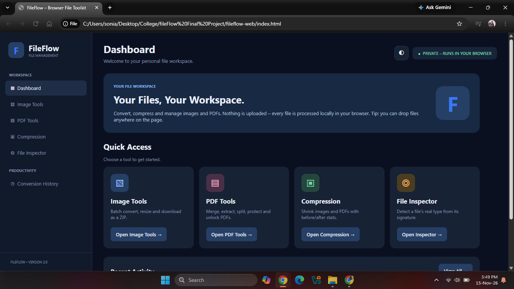
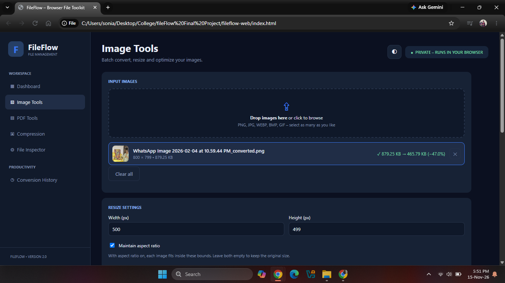
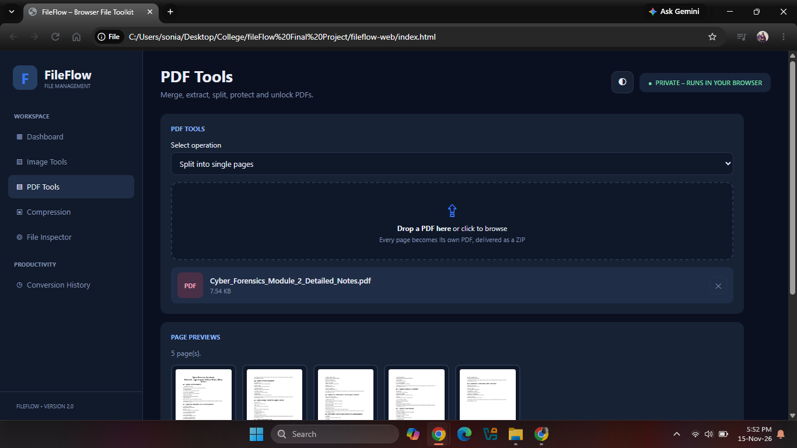

# FileFlow – Browser-Based File Conversion Toolkit

A privacy-friendly, browser-based file conversion and management toolkit built using **HTML, CSS, and JavaScript**.

FileFlow allows users to convert, resize, compress, merge, split, and manage files directly in their browser without uploading files to an external server.

## ✨ Features

### 🖼️ Image Tools
- Batch image conversion (PNG, JPG, WEBP, BMP).
- Image resizing with aspect-ratio lock.
- Image quality adjustment.
- Image preview and file-size comparison.
- Download converted images in ZIP format.

### 📄 PDF Tools
- Merge multiple PDF files.
- Extract selected PDF pages.
- Split PDFs into individual pages.
- Password-protect PDF files using AES-256 encryption.
- Remove PDF passwords.

### 📦 File Compression
- Image compression with quality presets.
- PDF compression with two modes:
  - Maximum Compression
  - Keep Text
- Batch processing and storage savings comparison.

### ⚙️ Additional Features
- Drag-and-drop file support.
- File Inspector for detecting actual file types.
- Searchable conversion history.
- Light and Dark themes.
- Browser-based file processing.

## 🛠️ Technologies Used

| Technology | Purpose |
|---|---|
| HTML5 | Application structure |
| CSS3 | Styling and responsive interface |
| JavaScript (ES2020) | Application functionality |
| Canvas API | Image processing |
| pdf-lib | PDF manipulation |
| PDF.js | PDF rendering and previews |
| qpdf WebAssembly | PDF encryption and optimization |
| JSZip | ZIP file generation |
| LocalStorage | Conversion history |

## 📸 Application Screenshots

### Homepage


### Image Converter


### PDF Tools


## 🚀 How to Run

1. Download or clone this repository.
2. Extract the project folder if downloaded as ZIP.
3. Open `index.html` in your browser.
4. Start using FileFlow.

No installation or build process is required.

**Note:** An internet connection is required for PDF features and ZIP downloads because supporting libraries are loaded from CDNs.

## 📁 Project Structure

```text
FileFlow/
│
├── screenshots/
│   ├── homepage.png
│   ├── image-converter.png
│   └── pdf-tools.png
│
├── index.html
├── style.css
├── script.js
└── README.md
```

## 🔒 Privacy

FileFlow processes files directly within the browser. Files are not uploaded to an application server.

## 👩‍💻 Developer

**Anvi Soni**

B.Sc. Cyber Security

## 📌 Project Information

- Project Name: FileFlow
- Project Type: Web Application
- Category: File Conversion and Management
- Development: HTML, CSS and JavaScript

---

*FileFlow – Your files, your control.*
